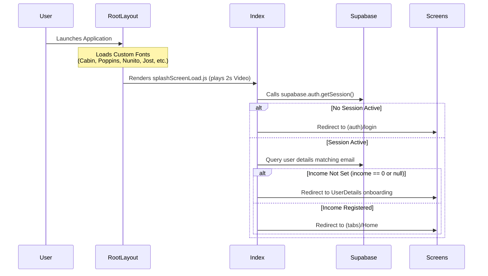
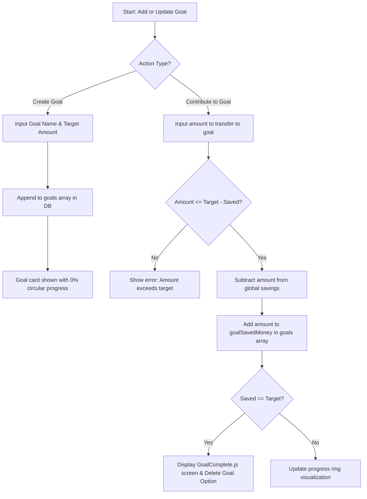

# Budgeting App: Logic and Implementation Guide

This guide details the system architecture, file structure, database schema, and operational logic of the **Budgeting App** (built with Expo, React Native, Supabase, and Tailwind CSS / NativeWind).

---

## 📂 Project Structure Overview

Below are the key folders and files in the application structure:

*   **[`app/`](file:///d:/Arush/budgeting-app/app)**: File-system based router navigation.
    *   **[`app/_layout.jsx`](file:///d:/Arush/budgeting-app/app/_layout.jsx)**: Root container configuring typography, theme context providers, and navigation stacks.
    *   **[`app/index.jsx`](file:///d:/Arush/budgeting-app/app/index.jsx)**: Entry point handling user session validation, routing to Onboarding or Dashboard.
    *   **[`app/(auth)/`](file:///d:/Arush/budgeting-app/app/(auth))**: Registration and Login flows.
    *   **[`app/UserDetails/`](file:///d:/Arush/budgeting-app/app/UserDetails)**: Core onboarding page for first-time profile setups.
    *   **[`app/profile/`](file:///d:/Arush/budgeting-app/app/profile)**: Account details, profile editing, and PDF report exports.
    *   **[`app/Support/`](file:///d:/Arush/budgeting-app/app/Support)**: Help/FAQ placeholder page.
    *   **[`app/(tabs)/`](file:///d:/Arush/budgeting-app/app/(tabs))**: Main application tab navigation structure (`Home`, `Expenses`, `Goals`).
*   **[`components/`](file:///d:/Arush/budgeting-app/components)**: Contains visual components separated by scope:
    *   **[`components/expense/`](file:///d:/Arush/budgeting-app/components/expense)**: Elements specific to display items and pickers.
    *   **[`components/modals/`](file:///d:/Arush/budgeting-app/components/modals)**: Action sheets for adding assets, expense creation, category pickers, and alerts.
    *   **[`components/globalState/`](file:///d:/Arush/budgeting-app/components/globalState)**: Shared context files.
    *   **[`components/home/`](file:///d:/Arush/budgeting-app/components/home)**: Dashboard visualization elements (e.g., charts, history sections).
*   **[`lib/`](file:///d:/Arush/budgeting-app/lib)**: Integrations and utilities:
    *   **[`lib/supabase.js`](file:///d:/Arush/budgeting-app/lib/supabase.js)**: Configures the Supabase Client with `AsyncStorage` persistence.
    *   **[`lib/utils.jsx`](file:///d:/Arush/budgeting-app/lib/utils.jsx)**: Calculations for monthly averages, balance, recurring tasks, and overlays.
*   **[`constants/Theme.jsx`](file:///d:/Arush/budgeting-app/constants/Theme.jsx)**: Defines full Light and Dark custom palettes.

---

## 🗄️ Database Architecture (Supabase)

The application communicates with a Supabase PostgreSQL instance. All user-specific settings, income streams, expenses, and savings goals are housed in the single table: **`User Data`**.

### Database Schema Structure

| Column Name | PostgreSQL Type | Description |
| :--- | :--- | :--- |
| `email` | `text` (Primary Key) | Authenticated email address used to query matching profile data. |
| `username` | `text` | The display name specified by the user. |
| `income` | `numeric` | User's fixed monthly income. |
| `savings` | `numeric` | Running liquid balance (Income - Expenses - Saved Goal Money). |
| `expenses` | `jsonb` (Array) | Array of JSON structures representing single transactions. |
| `goals` | `jsonb` (Array) | Array of JSON structures representing active/completed saving goals. |

#### JSON Structure: Expense Item
```json
{
  "expenseId": "string (UUID)",
  "expenseName": "string",
  "expenseAmount": 1500,
  "paymentMode": "string (e.g., Cash, Card, UPI)",
  "expenseDate": "string (formatted: 'Month Day Year')",
  "expenseCategory": "string",
  "expenseType": "string ('Non-Recurring' | 'Recurring')"
}
```

#### JSON Structure: Savings Goal
```json
{
  "goalId": "string (UUID)",
  "goalName": "string",
  "goalTargetMoney": 10000,
  "goalSavedMoney": 2500
}
```

---

## 🔄 Core Operational Logic & Flows

### 1. App Bootstrapping & Routing Sequence

The sequence below manages user transitions from launching the application to landing on the appropriate screen:



*   **Auth State Context Provider**: [`UserContext.js`](file:///d:/Arush/budgeting-app/components/globalState/UserContext.js) listens to auth updates via `onAuthStateChange`. This hook supplies the global user context to components, avoiding prop-drilling.

---

### 2. User Onboarding Flow

First-time registrations prompt users with the **[`app/UserDetails/index.jsx`](file:///d:/Arush/budgeting-app/app/UserDetails/index.jsx)** screen:
1.  **Form Entry**: Enter a `username` and `monthly income`.
2.  **Submit Logic**:
    *   Validates that the input amount is a positive number.
    *   Initializes the database entry via `upsert` under the authenticated email:
        *   Sets `income` to the specified amount.
        *   Sets initial `savings` equal to the specified `income` (no expenses recorded yet).
        *   Instantiates empty arrays for both `expenses` and `goals`.
3.  **Redirect**: Navigates the user directly to the Home dashboard (`/(tabs)/Home`).

---

### 3. Expense Management Logic

Transactions are handled inside the **[`app/(tabs)/Expenses.jsx`](file:///d:/Arush/budgeting-app/app/(tabs)/Expenses.jsx)** module.

#### A. Fetching and Rendering Transactions
*   The page triggers a fetch request using the active user's session email when focused.
*   Data is loaded into the local component state: `userExpenses`, `savings`, and `income`.
*   Expenses are filtered dynamically into tabs:
    *   **Non-Recurring Tab**: Shows normal individual monthly expenses.
    *   **Recurring Tab**: Displays subscription-based expenses that trigger periodically.

#### B. Adding a New Expense
*   **Validation Checks**:
    *   The app verifies that all fields (Name, Amount, Category, Type, Payment Mode) are filled.
    *   **Savings Limit Alert**: If `expenseAmount > currentSavings`, addition is blocked with a custom warning alert indicating insufficient savings.
    *   **Low Savings Warning Alert**: If the transaction drops `currentSavings` below **10%** of the user's monthly income (`incomePercent` threshold), the app alerts the user about low savings but allows saving.
*   **State Update**:
    *   Creates a new transaction object with a generated UUID.
    *   Combines the new transaction with the fetched list and updates the remote data on Supabase:
        ```javascript
        const updatedArray = [newExpense, ...previousExpenses];
        const updatedSavings = currentSavings - newExpense.expenseAmount;
        ```
    *   Updates the local state dynamically. Triggering a notification message "Expense Saved!".

#### C. Deleting an Expense
*   Identifies the target transaction to delete.
*   Recalculates current savings based on the remaining non-deleted transactions relative to the base income:
    ```javascript
    const updatedArray = previousExpenses.filter(e => e.expenseId !== selectedId);
    const totalExpenses = updatedArray.reduce((sum, e) => sum + e.expenseAmount, 0);
    const updatedSavings = baseIncome - totalExpenses;
    ```
*   Performs database write and triggers local state refreshes.

---

### 4. Savings Goals Tracking Logic

Goals are managed in **[`app/(tabs)/Goals.jsx`](file:///d:/Arush/budgeting-app/app/(tabs)/Goals.jsx)**.



*   **Refunding Goals**: If an user deletes a savings goal, any cash deposited inside `goalSavedMoney` is dynamically refunded and added back into the user's primary database `savings` value.

---

### 5. Profile & Account Settings Logic

Account and document options are configured inside **[`app/profile/index.jsx`](file:///d:/Arush/budgeting-app/app/profile/index.jsx)**.

#### A. Editing Profile & Override Warning
*   Users can alter their `username` and `income` details.
*   **Income Override Warning**: If a user updates their income value to a new figure (`oldIncome !== income`):
    *   A warning modal warns them: **"This will reset your data. Are you sure you want to make this change?"**
    *   If they confirm, the application updates the profile, sets `savings` to match the new income, and **purges all recorded expenses and goals** (`expenses: [], goals: []`).
*   **Username Update**: If the income value is unchanged, the profile simply updates the `username` in Supabase without affecting transactions or savings goals.

#### B. Log Out Routine
*   Clears user authentication context by calling `supabase.auth.signOut()`.
*   Redirects the device route back to the Login view (`/(auth)/login`).

#### C. Export PDF Reports
*   Allows users to select a target month and year.
*   Filters database transactions to find matching records.
*   **PDF Generation**:
    *   If transactions are found, the app compiles a styled HTML table with fields (Date, Amount, Category), calculating Total Expense and remaining Savings.
    *   Invokes `printToFileAsync` from `expo-print` to output a local PDF.
    *   Invokes `shareAsync` from `expo-sharing` to raise native OS share dialogs (AirDrop, Email, File Storage, etc.).
    *   If no transactions exist for the selected month/year, it triggers a custom "No Data" alert.

---

### 6. Support Screen

*   **Support Page**: Located in **[`app/Support/index.jsx`](file:///d:/Arush/budgeting-app/app/Support/index.jsx)**. Currently a placeholder page showing help information.

---

### 7. Utilities & Math Layout Calculations

Helper functions in **[`lib/utils.jsx`](file:///d:/Arush/budgeting-app/lib/utils.jsx)** execute client-side state adjustments:

*   **`numberWithCommas(value)`**: Formats numeric balances into the Indian numbering system format (e.g., `₹12,34,567`).
*   **`incomePercent(income)`**: Evaluates 10% of monthly income, used as the threshold limit for triggering low-savings notifications.
*   **`getGoalSavings(user)`**: Sums up the total funds currently locked within goals:
    $$\text{Goal Savings} = \sum \text{goalSavedMoney}$$
*   **`getTotalExpense(user)`**: Summarizes active expenses:
    *   **Non-Recurring**: Summed only if the expense date's month and year match the current month and year.
    *   **Recurring**: Dynamically added to total expenses if the current calendar day has reached or exceeded the billing `day` specified in the recurring item's setup date.

---

### 8. Dynamic Visual Elements

*   **Interactive Month Bar Chart**:
    *   Implemented via [`components/home/MonthChart.jsx`](file:///d:/Arush/budgeting-app/components/home/MonthChart.jsx) using `react-native-chart-kit`.
    *   Processes `expenses` records to match custom month configurations.
    *   Calculates the last 4 calendar months dynamically. Sums the total non-recurring transactions for each month, and plots them side-by-side using the theme's colors.
*   **Smooth Layout Transitions**:
    *   Uses React Native's `Animated` library.
    *   On entry, list items stagger (opacity increases from `0` to `1` and shifts translation Y from `50` to `0`) to create premium, responsive feel.
